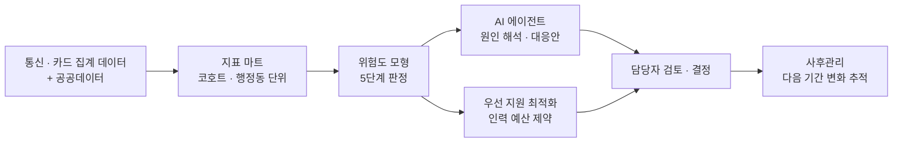

# 사회적 고립 예방 · 대응 AI 에이전트

**통신 · 카드 집계 데이터로 지역과 인구집단의 고립 위험 신호를 찾고, 한정된 복지 인력을 어디에 먼저 보낼지 제안하는 AI 에이전트**

2026 빅콘테스트 AI데이터활용 분야 출품작 · 팀장

-8CAAE6?style=flat-square&logo=scipy&logoColor=white)

 

> 이 저장소는 프로젝트 소개용입니다. 공모전 제공 데이터와 그 파생물은 외부에 공개할 수 없어, 분석 코드는 팀 전용 비공개 저장소에서 관리합니다.

## 한눈에 보기

| 항목 | 내용 |
|---|---|
| 기간 | 2026.09 ~ 2026.10 (10월 제출) |
| 팀 | 인하대학교 산업경영공학과 4인 |
| 내 역할 | **팀장** · 문제 정의와 분석 설계, 데이터 파이프라인 · 위험도 모형 · 에이전트 · 우선 지원 최적화 구현, 팀 협업 규칙 운영 |
| 팀원 역할 | 카드 · 통신 데이터 탐색적 분석(EDA) |
| 분석 지역 | 서울 강남구 · 강원 춘천시 |
| 데이터 | 통신(SK텔레콤) · 카드(신한카드) 집계 데이터, 행정동 경계 · 주민등록 인구 · 복지시설 공공데이터 |

## 문제

사회적 고립은 당사자가 먼저 도움을 요청하지 않는 경우가 많아, 복지 현장은 위험이 드러난 뒤에야 개입하게 됩니다.
반면 일상의 활동 데이터에는 외출이 줄고, 사람을 만나는 소비가 줄고, 생활 반경이 좁아지는 변화가 먼저 나타날 수 있습니다.

## 해결

개인을 추적하지 않고, **지역 · 인구집단 단위**의 집계 데이터에서 위험 신호를 찾습니다.
위험 수준은 통계 모형이 판단하고, AI는 원인 해석과 대응안 작성만 맡으며, 최종 결정은 담당 공무원이 내립니다.

## 핵심 설계

### 1. 두 단위의 위험도 모형

정답 라벨(실제 고립 여부)이 없어서, 역할이 다른 두 모형을 함께 썼습니다.

| 모형 | 단위 | 하는 일 |
|---|---|---|
| **활동 예측 기반 이상 탐지** | 시군구 × 성별 × 연령 코호트, 주 단위 | 다음 주 결제 활동을 예측하고, 활동량 · 사회적 교류 업종 비중 · 소비 다양성이 기대보다 떨어진 정도로 위험 점수와 **5단계**(안정 · 관찰 · 주의 · 경계 · 집중지원)를 산출 |
| **공공 대리지표 검증** | 행정동 | 유동인구 활동 지표가 1인가구 · 고령 인구 비율을 얼마나 설명하는지 확인하고, 활동 신호와 구조 취약성을 합쳐 행정동 위험 점수 산출 |

- 학습 모형과 단순 기준선(직전 주, 4주 평균)을 **walk-forward 방식**으로 비교해, 더 나은 쪽을 고르는 규칙을 미리 정해 두었습니다.
- 가중치를 무작위로 흔들어도 위험 순위가 유지되는지 민감도를 확인했습니다.
- 휴일 주간처럼 경보가 몰리는 구간은 따로 표시해, 위험 단계를 절대 판정이 아닌 **우선순위 신호**로 쓰도록 했습니다.

### 2. AI 에이전트

`위험 신호 탐지 → 위험 수준 판단 → 원인 분석 → 대응 방안 · 복지자원 추천 → 우선 지원 대상 → 사후관리`

- **숫자는 모형이, 문장은 LLM이.** 위험 수준은 통계 모형이 정하고, LLM은 원인 해석과 대응안 문장만 작성합니다.
- **낙인 표현을 막았습니다.** LLM 출력은 "고립자", "외톨이" 같은 낙인 표현 검사를 통과해야 하고, 걸리면 규칙 기반 문장으로 바꾼 뒤 로그에 남깁니다.
- **개인 단위로 추론하지 않습니다.** 대상은 지역과 인구집단이며, 복지자원 안내는 담당자가 최신 공고로 확인하도록 했습니다.
- **효과와 변화를 구분했습니다.** 개입 기록이 없으므로 사후관리는 "효과 측정"이 아니라 다음 기간 위험 점수의 "변화 관찰"로 정의했습니다.

### 3. 우선 지원 대상 최적화

한정된 복지 인력시간 안에서 어느 행정동 × 집단(노년 · 청년)에 어떤 수준(기본 안내 · 집중 방문)의 대응을 배분할지 **정수계획**으로 정합니다.

- 목표: 집단 위험도 × 행정동 취약도 × 대상 인구 × 도달률 × 효과의 합을 최대화
- 제약: 총 인력시간 예산, 시군구별 최소 배분, 단위당 대응 수준 하나
- 도달률 · 효과 · 비용은 시나리오 가정이라, 가정을 바꿔도 선택 결과가 유지되는지 민감도 분석으로 확인했습니다.

## 팀 운영

4인 팀이 같은 코드를 다루면서 데이터가 새지 않도록 작업 방식을 먼저 정했습니다.

- **브랜치 · PR 규칙**: main 직접 푸시 금지, 기능별 브랜치와 팀원 확인 후 병합
- **데이터 보호**: 공모전 원본 데이터와 행 단위 파생물은 저장소에 올리지 않고, 커밋 단계에서 데이터 · API 키를 차단하는 훅 적용
- **재현성**: 경로와 상수는 한 파일에서만 관리하고 난수 시드를 고정, 계약 테스트(pytest)로 산출물 형식을 검증
- **의사결정 기록**: ERD, 회의 정리, 의사결정 로그를 문서로 남겨 팀원이 같은 근거로 판단

## 기술 스택

| 구분 | 사용 기술 |
|---|---|
| 데이터 처리 | Python, pandas, Parquet, Shapely · pyproj (행정동 공간 조인) |
| 모델링 | scikit-learn (릿지, 그래디언트 부스팅), walk-forward 검증 |
| 최적화 | SciPy 정수계획 (HiGHS) |
| AI | Claude API (원인 해석 · 대응안 작성, 호출 로그 기록) |
| 품질 | pytest 계약 테스트, Git 훅, 브랜치 · PR 규칙 |

 

팀장 · 신재우 · <a href="https://13jvv.github.io/">포트폴리오</a>

